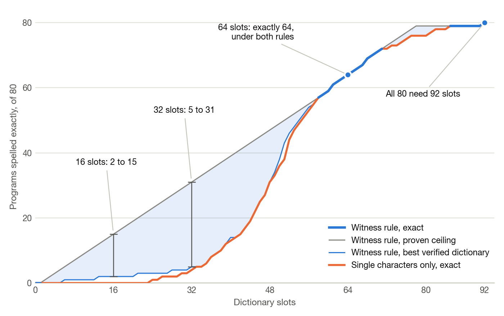

# Witness-rule coverage curve for compact matched80

How many of the 80 frozen compact JavaScript programs can a dictionary of K entries spell exactly?
This folder holds the frozen inputs of the figure, a checker that replays every plotted point, and a
checker for the unrestricted curve that supplies most of the ceilings.

Source bytes are read from Gamma commit `59ff04415ff2afd04ff2ed451340f4f02852bf18`, with the original
trailing newlines. Nothing here changes `sixbit-v1`.

## The rule

- A single character is always an eligible entry.
- A longer entry must occur in at least two of the 80 programs.
- No entry is a whole program.

## Result

**Spelling all 80 programs needs exactly 92 entries.** The rank of the forced blocks gives the lower
bound and the 92 single characters are a matching dictionary.

| Slots | Programs spelled exactly | Status |
| --- | --- | --- |
| 0 to 1 | 0 | exact |
| 16 | 2 to 15 | interval |
| 32 | 5 to 31 | interval |
| 56 | 54 to 55 | interval; a solver reports 54 as the maximum, which is not a checked proof |
| 58 to 60 | slots − 1 | exact |
| 61 to 67, including 64 | slots | exact |
| 68 to 71 | slots + 1 | exact |
| 72 to 84 | within 1 to 3 programs | interval |
| 85 to 91 | 79 | exact |
| 92 | 80 | exact |

The value is exact at 24 of the 93 budgets. `coverage.json` has every budget; `witness-coverage.csv`
is the same table as plotted.



## What the two ends of an interval mean

- **Lower end: a dictionary that exists.** It counts the programs a stored dictionary spells. The
  dictionary and the ids of the programs it spells are in `coverage.json`, and `check_coverage.py`
  replays it against the pinned bytes.
- **Upper end: a proof.** Up to 78 slots it is the exact unrestricted maximum, because every witnessed
  dictionary is also an unrestricted one. From 79 to 91 slots it is 79, because all 80 need 92.
- **Search effort is recorded apart from both.** `search-effort.json` lists the solver runs, their time
  limit and what they found. Six of the seven stopped at their limit, which proves nothing about the
  maximum. The run at 56 slots finished: the solver reports its 54-program dictionary as optimal. That is
  a solver's claim, not a checked proof, so the proven ceiling at 56 slots stays 55. No run is used as a
  ceiling; a dictionary a run found is used as a lower end only after it is replayed.

## The single-character curve

`singleCharacters` is the most programs whose characters all fit in K single-character entries. The gap
between it and the lower end is what witnessed multi-character entries add:

- nothing from 58 to 71 slots, where single characters already reach the proven ceiling;
- one to three programs at most budgets from 6 to 32 slots (the first program is spelled at 6 slots;
  single characters spell none before 24);
- one to five programs from 49 to 56 slots, the most at 51 slots (43 against 38).

These are differences between the best dictionaries found, so below 58 slots they are floors on what
multi-character entries add.

Each single-character value is attained by a stored character set, which the checker replays. That no
larger set exists comes from an integer program and is not re-proved here.

## Check it

```sh
python3 -B check_coverage.py /path/to/gamma        # replays every dictionary; no solver
python3 -B check_unrestricted.py /path/to/gamma    # proves the unrestricted curve; no solver
python3 -B check_rank.py /path/to/gamma            # rank bounds and matching dictionaries; no solver
python3 -B make_figure.py                          # redraws the figure; needs matplotlib
shasum -a 256 -c SHA256SUMS
```

`check_unrestricted.py` and `check_rank.py` take an optional prime and base. Both have been run with
base 2 modulo 1,000,000,007 and base 3 modulo 998,244,353, with the same result.

## Files

| File | What it is |
| --- | --- |
| `coverage.json` | Frozen figure inputs: one row per budget, the dictionaries, the programs each spells, the single-character sets |
| `search-effort.json` | Solver runs, kept apart from the bounds |
| `check_coverage.py` | Replays every plotted point |
| `check_unrestricted.py` | Independent check of the exact unrestricted curve |
| `check_rank.py` | Rank lower bounds and matching dictionaries: 79 unrestricted and 92 under the witness rule, compact and canonical |
| `make_figure.py`, `witness-coverage.*` | The figure and its table |
| `search/` | How the dictionaries were found: single-character optimum, greedy builds, the stored 64-entry dictionary shrunk, and the frozen `sixbit-v1/model.py` at other budgets. Not needed to check anything. |

## Limits

- One corpus and one format. The curve changes if the trailing newlines are removed.
- Between 2 and 57 slots the interval is wide. The lower ends there are the best dictionaries found, not
  optima.
- The ceilings rest on two results: the unrestricted curve (`check_unrestricted.py`) and the 92-entry
  minimum (`check_rank.py`; also certified in `sixbit-v1`).
- This counts entries. It says nothing about key presses or typing speed.
