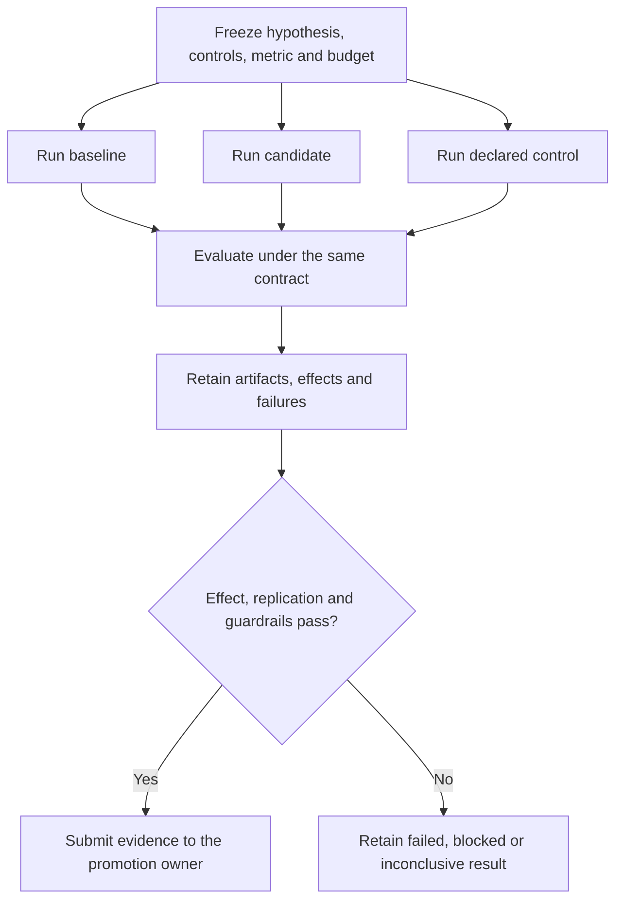
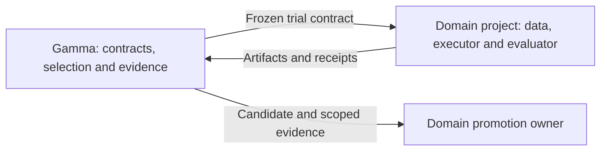

# SAME-R

**SAME-R** means **Swappable Approaches under Matched Evaluation and Replication**.
It is Gamma's method for comparing changes to data, prompts, training, models,
rules, routing, or execution under a declared experiment contract.

The approach can change. The objective, controls, evaluation population, success
metric, guardrails, and replication policy stay fixed. Results belong to the
specific workload and contract that produced them.

This README owns the overview, current implementation status, and commands.
The [full specification](SPEC.md) retains the method, application profiles, and
historical evidence. Its [ownership map](SPEC.md#specification-ownership) links
each detailed rule to one authoritative document.

## How a comparison works



Freeze the intervention and its allowed differences before execution. Match the
conditions needed to attribute an effect; each approach can use its own declared
internal mechanism. Selection and final replication use separate evidence.
Passing a test or choosing a candidate does not automatically authorize promotion.

For example, to test targeted training-data replacement, compare an unchanged
anchor, targeted replacement, and matched random replacement. Keep row count,
replacement positions, training recipe, evaluation, and seed policy fixed. The
targeted lane must satisfy the frozen rule against both controls. Lower training
loss alone cannot establish the claimed gain. See the [controlled data lanes](SPEC.md#controlled-data-lanes)
for the complete requirements.

## Who owns what



SAME-R owns the comparison method, schemas, experiment register, and selector
rules. Domain projects own their data, executors, evaluators, artifacts, and
promotion decisions. The method cannot make a weak benchmark authoritative or
turn a result from one domain into a general capability claim.

## What is implemented

| Component | Current boundary |
|---|---|
| [Contract suite](contracts/README.md) | JSON Schema, a synthetic example, semantic validator, and contract tests. Validation is separate from experimental success. |
| [Experiment register](experiments/README.md) | Pointer-only records and validation of pinned revisions, hashes, and available evidence. Domain artifacts remain with their owners. |
| [Selector prototype](selector.py) | In-memory registry and history, priority/effect-based approach selection, saturation checks, and selection receipts, covered by [unit tests](test_selector.py). |
| Domain execution | Domain-specific scripts and evaluators, including [Simulatte construction](domains/simulatte/README.md) and [browser adapter evaluation](domains/tinker_browser/README.md). |
| Automatic recursive selection | Specified, but no qualified integrated service or demonstrated selection advantage. The [implementation gate](SELECTOR_AND_SATURATION.md#implementation-gate) remains applicable. |

The prototype's objects and receipts are not integrated with the full canonical
contract suite. It does not enforce the complete participant, label-authority,
recursive accounting, or promotion contract. Its tests establish bounded
mechanics, not contract conformance or better experimental decisions.

[Retained historical results](SPEC.md#evidence-for-the-outer-contract) came from
operator or domain-script selections. They do not qualify automatic cross-domain
selection, recursive self-selection, or autonomous promotion. Historical profiles
also do not reopen archived research lanes.

## Validate the existing machinery

From the Gamma repository root:

```bash
python3 projects/samer/contracts/validate_same_r_contract.py
python3 projects/samer/experiments/validate_experiment_register.py
python3 -m unittest projects.samer.test_selector
python3 tests/test_samer_contracts.py
python3 tests/test_experiment_register.py
```

These commands validate existing fixtures, records, and implementation mechanics.
They do not download models, launch training, or rerun the registered experiments.

## Detailed references

- [Full specification](SPEC.md): outer algorithm, capability-transfer profile,
  operating loop, artifact layout, examples, and adoption checklist.
- [Causal and evidence contracts](CAUSAL_AND_EVIDENCE_CONTRACTS.md): intervention
  attribution, lineage, contamination, invalidation, and promotion requirements.
- [Selector and saturation contract](SELECTOR_AND_SATURATION.md): automatic,
  multi-model, cross-domain, and recursive selection requirements.
- [Worked applications and claim boundaries](SPEC.md#worked-applications-and-claim-boundaries):
  retained translation, WGSL, and grounded-extraction examples.
- [Verifier-guided learning taxonomy](../../docs/VERIFIER_GUIDED_LEARNING.md):
  optimizer, reward, and RLVR terminology.
